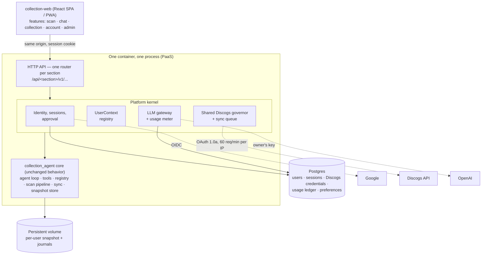
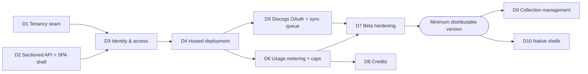

# Collection Agent — Trusted-User Distribution: High-Level Solution & Roadmap

Status: **draft for SDD input** (2026-11-23). This document is not a spec.
It fixes the direction, the target architecture and the feature slicing; each
roadmap item below becomes its own `specs/NNN-*` feature where details are
refined.

## 1. Goal

Turn the collection agent — today a single-user tool that runs on the owner's
LAN with the owner's Discogs token — into a hosted web app that a small group
of trusted people can use, each against their own Discogs collection.

The **minimum distributable version** is reached when a friend can, from their
phone and without touching a terminal:

1. sign in with Google and wait for the owner's approval;
2. connect their own Discogs account;
3. sync, scan records, chat, and move records between folders — exactly what
   the owner can do today;
4. see what their usage has cost, and be stopped at a monthly cap the owner
   sets.

### Owner decisions already taken (2026-11-23)

| Topic | Decision |
|---|---|
| Hosting | A simple PaaS (Fly.io / Render / Railway class): one container, managed Postgres, automatic TLS. Must stay portable to AWS later. |
| Scale | Up to ~10 trusted users in the first stage. |
| Frontend | A new React + Vite + TypeScript + Tailwind single-page app, installable as a PWA, mobile-first. Native iOS/Android is a later option. |
| LLM cost | Everyone uses the owner's OpenAI account. From day one, usage is measured per user, visible to that user, and limited by a per-user monthly cap. |
| Credits | Later: a transparent pay-for-what-you-use system at cost, with no margin. |
| Access | Google login (or similar) plus an owner-managed whitelist. |
| Discogs | Each user connects their own account through Discogs OAuth. |
| Evolvability | Scan, Chat and Collection must be updatable independently, without disruptive changes. |

### Non-goals for this roadmap

- Public sign-up, or any scale beyond a trusted group.
- Horizontal scaling, multi-region, high availability.
- Offline use of the app.
- Changes to `etl/`, `agent/`, `frontend/` (the analytics demo) or
  `collection_matcher` — all untouched.
- Changes to identification accuracy, the vision prompt or the eval harness.
  The owner's eval and photo-retention tooling stays a local, CLI-only
  capability.

## 2. Where we start

The domain logic is already cleanly injectable. `create_web_app` receives its
settings, LLM client, Discogs client, snapshot store, scan session, chat and
sync runner as arguments; the agent loop and the scan pipeline take their
clients as parameters. What is single-user is the **composition**: exactly one
of each object is built per process, from one `.env`.

This table is the full inventory of state that is global today and must become
per-user. It is the core of the tenancy work.

| State | Today | Target |
|---|---|---|
| Discogs credential | Personal token in `.env`, required by `Settings` | Per-user OAuth 1.0a token + secret, encrypted in Postgres. The personal token survives only in local mode. |
| Discogs username | Resolved once at startup | Per user, from `GET /oauth/identity` at connect time |
| Snapshot, sync journal, live-writes marker | One path (`data/snapshot.json`) | One directory per user |
| Scan journal | One directory | One directory per user |
| `ScanSession` (candidate allowlist, session adds, open cycles) and the supersede counter inside `scan/server.py` | One per server run | One per user |
| `WebChat` (transcript, pending write plan, busy lock) | One per process | One per user |
| `SyncRunner` | One per process | Per-user status behind one shared queue |
| `RateLimitGovernor` | One per `DiscogsClient` | **One per process**, shared by every user (see §3.5) |
| Scan target folder | A `Settings` field validated live at startup | A per-user preference validated when set |
| OpenAI client | One per process | Still one per process, wrapped per user for metering |
| Photo retention, eval | Settings flag | Local mode / owner only |

Three facts about the current system shape the design more than anything else:

- **Discogs throttles per source IP** (60 requests/minute), not per token. On
  one server every user shares one budget. A first sync of a 400-record
  collection takes about seven minutes of that whole budget.
- **Per-user session state lives in memory** (allowlists, pending plans, busy
  locks). This is what makes the write gates safe, and it means the app runs
  as a single process until that state is moved elsewhere.
- **The snapshot is a cache.** Everything in it can be rebuilt from Discogs by
  a sync. Losing it costs minutes, not data.

## 3. Target architecture

### 3.1 Overview



Four layers, each with one job:

- **Core** — today's `collection_agent` domain code. Its behavior does not
  change; it only stops assuming there is one user.
- **Platform kernel** — the new multi-user plumbing: who is calling, what is
  theirs, what it costs, and how the shared Discogs budget is divided.
- **Sections** — Scan, Chat, Collection, Account, Admin. Each is a thin HTTP
  router over the core, with its own versioned contract.
- **Web client** — the SPA, organized in the same sections.

### 3.2 Components and repository layout

| Component | Change |
|---|---|
| `collection-agent/` | Keeps the core and the CLI. Gains the platform kernel and the sectioned API as new packages composed over the core (the 028 "composition, not modification" approach). |
| `collection-web/` (**new**) | The SPA. A fifth independently built component; it talks to the backend only through the published HTTP contract. Requires a PATCH amendment to Constitution Principle VI's component list. |
| `frontend/`, `agent/`, `etl/` | Untouched. |

In production the API container serves the SPA's built static files, so the
browser sees a single origin. That removes CORS, keeps session cookies simple,
and makes the deployment one PaaS service plus one database. During
development the SPA runs on the Vite dev server and proxies `/api` to the
backend.

### 3.3 Two run modes, one code path

| Mode | Users | Auth | Discogs credential | Purpose |
|---|---|---|---|---|
| `local` | One implicit user built from `.env` | None (trusted LAN, as in 022/028) | Personal token | The owner's current workflow, CLI, eval, development |
| `hosted` | Many, from Postgres | Google login + approval | Per-user OAuth | The distributable app |

Local mode is hosted mode with a single pre-built `UserContext`. Both run the
same routers and the same core. This keeps the 639 existing tests meaningful,
keeps the CLI working, and means every section is developed and validated
locally before it is exposed.

In hosted mode the unauthenticated legacy routes (the 022/028 `/api/*`
endpoints and the static scan page) are **not mounted**. They remain available
in local mode until the SPA reaches parity, and are then retired by their own
spec.

### 3.4 Tenancy: `UserContext`

A `UserContext` is everything that belongs to one user: identity, Discogs
client, snapshot store, journal directory, preferences, scan session, chat,
sync status and a metered LLM client. A process-wide registry builds contexts
lazily and hands the right one to each request after authentication.

Rules:

- A request can reach only its own `UserContext`. There is no API parameter
  that names another user. A structural guard test (in the tradition of the
  existing AST and grep guards) pins that every hosted route depends on the
  authenticated user.
- On-disk layout is `data/users/<user_id>/…` with the same files as today.
  `SnapshotStore` is already parameterized by path and already locks per path,
  so its semantics (atomic replace, sync journal, live-writes marker) carry
  over unchanged.
- `Settings` is split in two: deployment configuration (models, limits, URLs,
  secrets of the app itself) stays in `Settings`; anything per-user moves to
  the context. `DISCOGS_USER_TOKEN` stops being required outside local mode.

Snapshots stay as files on a persistent volume in the first stage, because
that changes nothing in the store's contract. The store sits behind an
interface so a database-backed implementation can replace it if stateless
deploys or more than one instance are ever needed.

Explicit constraint for this stage: **one instance, one worker process.**

### 3.5 Discogs: per-user OAuth, one shared budget

**Authentication.** Discogs uses OAuth 1.0a. The app is registered once with
Discogs (consumer key and secret live in the app's environment). A user
connects from the Account section: request token → redirect to Discogs →
callback with verifier → access token and secret → `GET /oauth/identity` to
record the username. `DiscogsClient` gains a pluggable auth strategy
(personal token or OAuth); the endpoints it calls do not change.

**Credential storage.** Access token and secret are encrypted at the
application level before being written to Postgres, with the key supplied by
the environment and a key identifier stored per row so the key can be rotated.
Tokens never reach logs, responses, snapshots or traces — the existing
secret-hygiene discipline extends to them.

**Lifecycle.** Disconnecting deletes the credentials and offers to purge the
user's snapshot. A 401 from Discogs marks the connection as revoked and the app
asks the user to reconnect. One Discogs account can be linked to only one app
user.

**Rate budget.** Because the limit is per IP, the governor becomes a single
process-wide object and Discogs traffic is scheduled in two classes:

- *Interactive* — scan searches, adds, folder moves, on-demand pressings.
  These go first.
- *Background* — sync enrichment. Syncs run through one queue, one at a time,
  yielding to interactive requests. The user sees "queued, position N".

At ten users this is enough. If it stops being enough, the next step is more
egress IPs, which this design does not preclude.

### 3.6 Identity and access

- **Sign-in:** OpenID Connect authorization-code flow with Google, handled by
  the backend. Users are keyed by the provider's stable subject id, not by
  email. The identity table is provider-agnostic so a second provider is an
  additive change (and Sign in with Apple will be mandatory if the app ever
  ships to the App Store with Google login).
- **Session:** a server-side session row in Postgres, referenced by an opaque
  id in an `HttpOnly`, `Secure`, `SameSite=Lax` cookie, with CSRF protection on
  state-changing requests. The API reads "current user" through one dependency,
  so a bearer-token scheme for native shells can be added later without
  touching the sections.
- **Whitelist:** a user is `pending`, `approved` or `suspended`. A first
  sign-in from an unknown account creates a `pending` user who sees a "waiting
  for approval" screen and can reach nothing else. The owner approves from the
  Admin section, or pre-approves an email before the person signs in.
- **Owner bootstrap:** owner accounts are named in the environment and receive
  the admin role on first sign-in.

Considered and not chosen: a zero-code gate such as Cloudflare Access in front
of the app. It would deliver Google login and an email allowlist with no code,
but identity has to live inside the app anyway — metering, credits and the
Discogs link all hang off the user record — and it would tie the app to one
edge provider.

### 3.7 LLM gateway, metering and caps

Every OpenAI call (chat turns and scan vision) already flows through one
injectable client. In hosted mode each `UserContext` gets that client wrapped
by a **metering gateway** that:

1. checks the user's remaining budget before the call and refuses with a typed
   `quota_exceeded` error when the cap is reached;
2. records one immutable **usage event** after the call: user, feature
   (`chat` or `scan_vision`), model, input/output/cached tokens, the unit
   prices applied, and the resulting cost;
3. tags the LangSmith trace with the user so cost and traces can be
   reconciled.

Design points:

- **The ledger is append-only and self-explaining.** Each event stores the
  unit prices it was computed with, so a user can audit any line and a later
  price change never rewrites history. Prices come from a versioned,
  settings-sourced table.
- **Caps are soft by one call.** The check happens before each LLM call and
  the cost is known after, so a user can overshoot by at most one call.
- **Two backstops against a runaway bill:** an app-wide monthly ceiling that
  pauses LLM features for everyone, and a hard limit configured on the OpenAI
  project itself.
- **Visibility.** Each user has a Usage page (month to date, split by feature,
  line-by-line events, cap progress). The owner sees per-user totals and edits
  caps in Admin.

This ledger is deliberately the foundation of the credits system: credits
later add top-ups and a balance on top of the same events (see §4, D8).

### 3.8 Sections that evolve independently

The requirement is that Scan, Chat or Collection can be reworked without a
disruptive change elsewhere. The design answers it with the same boundary on
both sides of the wire.

**Backend.** Each section is a router package with its own contract document
and its own version: `/api/scan/v1/…`, `/api/chat/v1/…`,
`/api/collection/v1/…`, `/api/account/v1/…`, `/api/admin/v1/…`. Sections
depend on the platform kernel and the core, never on each other. Within a
version, changes are additive only; a breaking change ships as `v2` of that one
section while `v1` keeps serving until the client has moved.

**Frontend.** The SPA mirrors that split:

```text
collection-web/src/
  platform/        session, API client, design system, usage banner, section registry
  features/
    scan/          routes, components, API bindings, state — self-contained
    chat/
    collection/
    account/       profile, Discogs connection, usage
    admin/         approvals, caps
```

- A **section registry** (id, label, icon, route, lazily loaded entry point,
  required capability) drives the navigation. Adding or replacing a section is
  one registry entry plus one folder.
- Features do not import each other; this is enforced by lint rules, as the
  backend boundary is enforced by an import guard test.
- TypeScript types are generated from the backend's OpenAPI schema, so a
  contract drift fails the build instead of failing on a phone.
- `GET /api/platform/v1/me` returns the user, their approval and Discogs
  connection state, a usage summary, and **which sections are enabled for
  them** — a per-user capability list that lets the owner roll a reworked
  section out to themselves first.

The result: a change to one section touches its router, its contract document
and its feature folder, and nothing else. Micro-frontends were considered and
rejected as far too heavy for this scale.

### 3.9 Mobile: PWA now, native later

The SPA ships as an installable PWA: web manifest, home-screen icon, and a
service worker that caches only the app shell (no offline data). Camera capture
keeps using the native file input that 022 already validated on phones.

Native apps stay possible without a rewrite because the SPA is API-first: a
Capacitor shell can wrap the same build. The work that path would add — bearer
tokens instead of cookies, sign-in through the system browser, Sign in with
Apple, store review — is isolated in the platform layer and listed as D10.

### 3.10 Security and privacy posture

Moving from a trusted LAN to the public internet replaces 022's "no auth, plain
HTTP" stance entirely.

- TLS everywhere (provided by the PaaS); secure cookies; CSRF protection.
- Authentication on every hosted route; tenant isolation pinned by tests.
- The write gates keep their current shape per user: adds only for
  server-served candidates, folder moves only by confirming the server-held
  plan. Request bodies still cannot inject write data.
- Secrets only in the PaaS environment; Discogs credentials encrypted at rest.
- Upload size limits (already present) and basic request throttling on sign-in
  and LLM endpoints.
- Admin actions are recorded in an audit log.
- A short, honest privacy note for users: photos and chat text are sent to
  OpenAI; traces may be stored in LangSmith; the owner operates the service
  and can see usage totals.
- Account deletion removes the user's credentials, snapshot, journals and
  chat history.

### 3.11 Operations

- **Deploy:** CI runs the test suites, builds one image (SPA build stage +
  Python stage) from locked dependencies, and deploys to the PaaS. This closes
  027's recorded follow-up on lockfile-frozen builds and CI.
- **Database:** managed Postgres with the provider's backups; schema changes
  through migrations.
- **Volume:** holds only rebuildable snapshots and the scan journals. Journals
  are the audit trail of collection writes and are worth a periodic backup.
- **Restarts:** in-memory state is lost by design — pending plans are voided
  and a running sync resumes from its journal when re-triggered, as today.
- **Observability:** structured logs with a user id, a health endpoint,
  LangSmith traces tagged per user.

## 4. Roadmap

Each item is sized to be one SDD feature. Identifiers are roadmap labels; spec
numbers are assigned when each feature is specified.



### Phase 0 — Foundations (local mode only, no visible change)

**D1 — Tenancy seam.** Introduce `UserContext` and the registry; split
deployment settings from per-user state; make the governor process-wide; give
`DiscogsClient` a pluggable auth strategy; move the scan server's closure state
into a per-user object. Local mode runs as one implicit user.
*Done when:* behavior is byte-identical in local mode, and a test drives two
contexts in one process with full isolation of snapshot, chat, scan session
and journals.

**D2 — Sectioned API and SPA shell at parity.** Publish the versioned
per-section API over the existing behavior, and build `collection-web` with
the platform layer, the section registry and the Scan, Chat and Collection
features at parity with today's tabbed page, installable as a PWA.
*Done when:* the owner completes the 028 validation checklist from the new app
on the LAN, in local mode.

D1 and D2 are independent and can proceed in parallel.

### Phase 1 — Owner online

**D3 — Identity and access.** Google sign-in, server-side sessions, user
states, owner bootstrap, the Admin approval screen, the pending screen, the
authentication dependency on every hosted route, and the Postgres schema with
migrations.
*Done when:* an unapproved Google account can reach nothing; the owner can
approve and suspend; the tenant-isolation guard is in place.

**D4 — Hosted deployment.** PaaS service, managed Postgres, persistent volume,
TLS and domain, secret management, CI/CD from locked builds, backups, runbook.
The owner is the only user and still uses the personal token.
*Done when:* the owner uses the app from a phone on mobile data for a full
scan-and-add session.

### Phase 2 — Trusted beta

**D5 — Discogs OAuth and shared-budget scheduling.** Discogs app
registration, the connect/disconnect flow, encrypted credential storage,
per-user scan folder preference, first-sync onboarding, the interactive
versus background scheduling and the sync queue.
*Done when:* two users with different Discogs accounts sync and scan
concurrently; neither sees the other's data; interactive scans stay responsive
while a sync runs.

**D6 — Usage metering and caps.** The metering gateway, usage ledger, price
table, per-user cap, app-wide ceiling, the Usage page, and cap management in
Admin.
*Done when:* every OpenAI call made in hosted mode has a ledger event; ledger
totals reconcile with the OpenAI usage dashboard for a test period; a capped
user is refused cleanly and sees why.

**D7 — Beta hardening.** Privacy note, account deletion, persisted chat
history (hosted restarts are frequent — this also closes 028's recorded
"no durable chat log" gap), onboarding copy, validation of both OAuth
redirects inside an installed iOS PWA, a restore drill.
*Done when:* a non-technical friend onboards alone from an invitation message.

**→ Minimum distributable version** is the end of Phase 2. D5 and D6 are
independent of each other; D6 can be released before D5 if cost visibility for
the owner's own usage is wanted earlier.

### Phase 3 — Credits at cost

**D8 — Credits.** Top-ups and a balance on top of the usage ledger; the cap
becomes "balance exhausted"; a per-user statement showing every charge at the
provider's list price with no margin. Start with **manual top-ups recorded by
the owner** (friends settle up outside the app), which keeps the system free of
payment-processor fees and of most compliance weight. Online payment is a
separate, optional follow-up, and its processor fee would appear as its own
transparent line.

### Phase 4 — Product evolution (independent of each other)

**D9 — In-app collection management.** Browse, search and organize the
collection inside the app instead of linking out to Discogs. This is the first
large section rework and the real test of §3.8.

**D10 — Native shells.** Capacitor packaging, bearer-token sessions,
system-browser sign-in, Sign in with Apple.

**Backlog that fits any time after D2:** chat token streaming; the recorded
`date_added` recency gap (029 candidate); the deferred "other pressings grouped
by master" scan UX; web `--full` sync.

## 5. Contracts and governance impact

| Area | Expected effect |
|---|---|
| Constitution | PATCH to Principle VI: add `collection-web/` as a component. |
| New contracts | Platform API (`/api/platform`), identity and access, usage ledger, one contract per section. |
| 028 `web-ui-api` | Superseded in hosted mode by the per-section contracts; kept verbatim for local mode until retired. |
| 017 `discogs-consumption` | Amendment: OAuth 1.0a as a second auth mode and the `/oauth/*` endpoints; process-wide governor. No change to the collection endpoints used. |
| 017 `snapshot-schema` | No schema change; the location becomes per-user. |
| 022 `scan-api` / journal schema | Session and journal become per-user; payload shapes unchanged. |
| 027 `docker-packaging` | Amendment or successor: multi-stage image with the SPA build, hosted run mode. |
| Principle VII(a) | All new knobs (caps, prices, OAuth client ids, encryption key, run mode) are settings-sourced. |

## 6. Open questions for the SDD phases

**To verify before committing to the design**

1. **Discogs rate limit under OAuth.** The reference says per source IP.
   Confirm empirically with two OAuth users from one IP; the scheduling design
   in §3.5 depends on it.
2. **Discogs API Terms of Use.** Review them for a multi-user app: attribution,
   limits on storing or caching data, image use, and anything touching
   cost-sharing. This gates D5.
3. **OpenAI terms for cost pass-through.** Confirm that charging users at cost
   for usage through the owner's account is acceptable. This gates D8, not the
   beta.
4. **iOS installed-PWA redirects.** Installed PWAs on iOS have historically
   handled cross-site redirects and cookies differently from Safari. Validate
   the Google and Discogs flows on a real device early in D3.

**To decide**

5. PaaS provider, and whether its persistent volume and Postgres offering fit
   (single instance pinned to a volume).
6. OAuth/OIDC library versus a hand-written flow. The repo's culture is
   minimal dependencies, but this is security-critical code.
7. For D1, extract per-user engines from the scan server's closure (the
   durable design), or keep `create_web_app` untouched and run one app instance
   per user behind an authenticating dispatcher (faster, preserves the
   zero-diff tradition, but harder to version by section).
8. LangSmith tracing for other people's data: on with disclosure, on without
   image payloads, or owner-only.
9. Default per-user cap and app-wide ceiling. Size them from the token usage
   021 already records for the owner's own sessions.
10. Whether syncs are only user-triggered or also refreshed in the background
    when the shared budget is idle.
11. Credits: accepted top-up methods and whether fixed hosting costs are
    shared pro rata or absorbed by the owner.
12. What happens to a suspended or deleted user's ledger history (kept
    anonymized for reconciliation, or purged).
